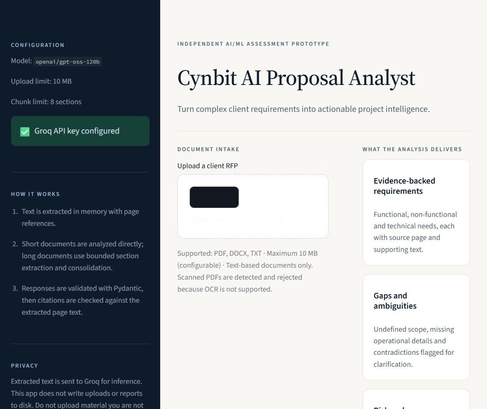

# Cynbit AI Proposal Analyst — MVP

An independent AI/ML assessment prototype proposed for **Cynbit Technologies**. It is **not** an official Cynbit
product and is not affiliated with or endorsed by Cynbit.

The app turns a client RFP (PDF, DOCX or TXT) into a validated, evidence-referenced analysis: requirements, gaps,
ambiguities, risks, clarification questions and a proposed solution direction. Every model response is validated with
Pydantic before it reaches the UI, and every cited page is checked against the extracted document text.



## What works

- Real Agnes inference (`agnes-2.5-flash` by default) through the OpenAI-compatible API; no mocked or hardcoded
  analysis in the running app.
- PDF (PyMuPDF), DOCX (python-docx) and TXT extraction, in memory, with page references.
- Scanned-PDF detection and rejection — OCR is explicitly out of scope.
- Ten analysis sections: executive summary, functional requirements, non-functional requirements, technical
  requirements, missing information, ambiguities, risks, clarification questions, solution recommendations and
  complexity assessment.
- Explicit vs inferred distinction (`origin`, `status`, `basis`, `confidence`).
- Prompt-injection resistance: document text is wrapped in an untrusted-content boundary, the closing tag is
  neutralised, and the system prompt treats embedded instructions as data.
- One bounded, targeted Pydantic repair attempt per stage (only the failed keys are requested; the document is never
  resent), then a clear failure. Truncated or incomplete JSON is detected before validation and never "repaired"
  from its own fragment.
- Long documents and capped findings: page-aware chunking → per-section `ChunkExtraction` → deterministic
  merge/dedupe → advisory pass. A `has_more` signal or a per-category cap switches a dense document to section mode
  instead of discarding findings.
- Extraction normalises redundant whitespace and removes only repeated digit-free page headers/footers. Page markers
  (`--- Page N ---`) are preserved for citations.
- Citation audit: page existence plus lexical evidence traceability (explicitly not semantic proof); only checks that
  failed are listed, and a fully verified report says so.
- Eight-tab dashboard, metric cards, and Markdown + JSON downloads.
- 110 offline tests (no API key needed) and a live ground-truth evaluation harness.

## Quick start

Requires **Python 3.11+** (verified on 3.11.9).

```powershell
python -m venv .venv
.venv\Scripts\Activate.ps1
pip install -r requirements.txt
Copy-Item .env.example .env
# Edit .env and set AGNES_API_KEY
python -m streamlit run app.py
```

Open `http://localhost:8501`. The key is read from `.env` (gitignored) or the process environment. On Streamlit
Community Cloud it is read from `st.secrets`.

### Configuration

| Variable | Default | Purpose |
|---|---|---|
| `AGNES_API_KEY` | — | Required for analysis |
| `AGNES_MODEL` | `agnes-2.5-flash` | Verified working default |
| `AGNES_BASE_URL` | `https://apihub.agnes-ai.com/v1` | OpenAI-compatible endpoint |
| `MAX_UPLOAD_MB` | `10` | Upload size cap |
| `MAX_DOCUMENT_CHARS` | `120000` | Hard extraction cap |
| `DIRECT_ANALYSIS_CHARS` | `24000` | Above this, long-document mode |
| `CHUNK_CHARS` / `CHUNK_OVERLAP_CHARS` | `12000` / `800` | Section size and overlap |
| `MAX_CHUNKS` | `8` | Bounded number of sections |
| `MAX_OUTPUT_TOKENS` | `16000` | Per-call completion cap (provider max 65,536) |
| `MAX_REQUEST_TOKENS` | `64000` | Prompt + completion budget (512K context window) |
| `MAX_FINDINGS_PER_CATEGORY` | `10` | Per-category cap; section mode or a warning when reached |
| `REQUEST_TIMEOUT_SECONDS` | `90` | Per-request timeout |
| `MAX_RETRIES` | `3` | Bounded retries for 429/413/5xx only |
| `TEMPERATURE` | `0.1` | Low randomness |

Analysis is split into a findings call and an advisory call to keep each request bounded. The Agnes API is
OpenAI-compatible, so calls go directly to `AGNES_BASE_URL` with `httpx`; the Groq SDK is kept only for its typed API
errors, because its chat resource hardcodes its own `/openai/v1` path. Retry timing honours provider headers when
present. A direct-mode live run took about 3 minutes (including one transient retry); allow 1–3 minutes.

## Tests

```powershell
python -m pytest -q
```

**Actual result: 110 passed** (`........................................................................ [100%]`). Tests are fully offline and use an
injected fake client; they cover extraction/normalisation, chunking, schemas, targeted validation/repair,
truncation diagnostics, retry bounds, non-retryable errors, usage logging, the Analyze overlap guard, UI contrast,
exports and the evaluation matcher.

## Live evaluation

```powershell
python evaluation/evaluate.py
```

This calls the real API against `sample_data/sample_rfp.pdf` (a synthetic 4-page RFP with deliberate gaps,
contradictions and an injected instruction) and writes `evaluation/results.json`. The results below were measured on
2026-10-29 with the previous `openai/gpt-oss-120b` (Groq) default and have **not** been re-run against
`agnes-2.5-flash`:

| Metric | Result |
|---|---|
| Structured output valid | 1 / 1 run |
| Requirements — overall | precision 0.950 · recall 0.905 · F1 0.927 |
| Functional requirements | precision 1.000 · recall 1.000 · F1 1.000 |
| Non-functional requirements | precision 0.875 · recall 0.778 · F1 0.824 |
| Missing information | precision 1.000 · recall 0.667 · F1 0.800 |
| Technical requirements | precision 0.857 · recall 0.857 · F1 0.857 |
| Ambiguities | precision 0.500 · recall 0.200 · F1 0.286 |
| Risks | precision 0.400 · recall 0.400 · F1 0.400 |
| Citation traceability | 23 / 34 checks (67.6 %) |
| Runtime / tokens | 41.29 s (includes a rate-limit wait) · 9,931 tokens |

These are one-run results on one synthetic document, matched lexically. They are not a benchmark and do not
generalise. The weak ambiguity/risk scores are real and are discussed in `docs/technical_approach.md`.
## Project layout

```
app.py                      Streamlit UI, dashboard, downloads
src/config.py               Settings, env/secrets loading
src/document_processor.py   Validation, extraction, page map, chunking
src/prompts.py              System prompt, untrusted wrapping, stage prompts
src/schemas.py              Pydantic v2 models and enum coercion
src/analyzer.py             LLM orchestration, budgets, retries, repair
src/validator.py            Merge/dedupe, ID normalisation, citation audit
src/ui_state.py             Streamlit-free UI guard predicates
src/report_export.py        Markdown and JSON reports
tests/                      110 offline tests
evaluation/                 Ground truth, live evaluator, measured results
sample_data/                Synthetic RFP (.txt source, .pdf input)
docs/                       Opportunity report, technical approach, screenshot
```

## Documentation

- [`docs/opportunity_report.md`](docs/opportunity_report.md) — problem, users, Cynbit fit, scope, hypotheses.
- [`docs/technical_approach.md`](docs/technical_approach.md) — architecture and engineering decisions.
- [`evaluation/README.md`](evaluation/README.md) — dataset, method, metric definitions and limitations.

## Security and privacy

- The API key is never logged, rendered or committed. `.env`, `.env.*`, `.streamlit/secrets.toml` are gitignored.
- Uploads are processed in memory and never written to disk by the app.
- Extracted text is sent to Agnes for inference; the sidebar states this before upload.
- HTML generated with `unsafe_allow_html` is escaped where it contains document or model text.
- Logs contain counts, modes and error types — not document content, filenames or keys.

## Known limitations / not done

- No OCR, so scanned PDFs are rejected.
- No user accounts, persistence, database or audit log.
- Citation checks are lexical; they prove the cited page exists and words overlap, not that the interpretation is right.
- Long-document mode can split or merge requirements that span sections.
- Ambiguity and risk extraction scored poorly on the single evaluation run.
- No cost, timeline, team-size or ROI estimates by design.
- The template RFP is synthetic; no real client documents were used.
- **Not deployed and not pushed to GitHub.** See below for the steps.

## Publish to GitHub

The repository already has commits. To publish this working tree:

```powershell
git add .
git commit -m "Build Cynbit AI Proposal Analyst MVP"
# Create an empty repository on GitHub, then:
git remote add origin https://github.com/<your-user>/<your-repo>.git
git push -u origin main
```

Confirm `.env` is not staged (`git status --short`) before pushing. `evaluation/results.json` is included as
evidence of the measured run; `evaluation/last_run.log` is ignored.

## Deploy (Streamlit Community Cloud)

1. Push the repository to GitHub.
2. On <https://share.streamlit.io>, create an app pointing at `app.py` on the `main` branch.
3. Add `AGNES_API_KEY` under **App settings → Secrets**:

   ```toml
   AGNES_API_KEY = "sk-..."
   AGNES_MODEL = "agnes-2.5-flash"
   AGNES_BASE_URL = "https://apihub.agnes-ai.com/v1"
   ```

4. Deploy and wait for the health check. Provider rate limits still apply in production; concurrent users will queue
   on rate limits.

Deployment was **not** performed as part of this build, so the live URL is unverified.

---

Independent prototype — not an official Cynbit product. AI output is decision support and requires human review.
