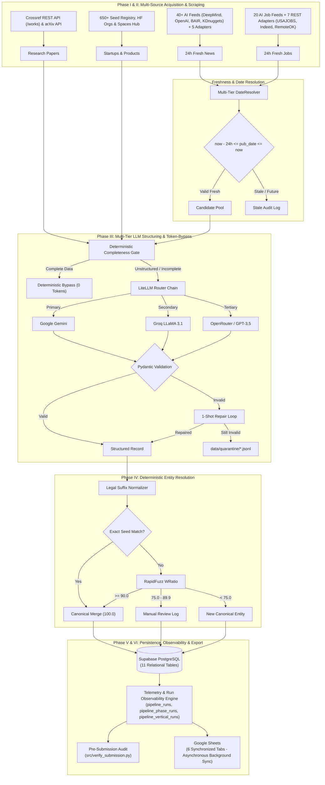

# AI Data-Intelligence Ingestion Pipeline

An end-to-end multi-vertical ingestion engine designed for high-throughput structured extraction, anti-bot scraping, deterministic entity resolution, Supabase PostgreSQL persistence, and Google Sheets synchronized export across 6 unified tabs.

---

## 🏗️ System Architecture



---

## 📋 Record Types & Schema Hierarchy

| Record Type | Key Hierarchy | Required Top-Level Fields |
| :--- | :--- | :--- |
| **`STARTUP`** | `source.name`, `source.url`, `content.entityName`, `content.data.employeeCount` | `schemaVersion`, `recordType`, `source`, `content`, `collectedAt` |
| **`PRODUCT`** | `source.name`, `source.url`, `content.startupName`, `content.pricingModel` (`FREE`/`FREEMIUM`/`PAID`/`ENTERPRISE`) | `schemaVersion`, `recordType`, `source`, `content`, `collectedAt` |
| **`RESEARCH_PAPER`** | `content.title`, `content.authors`, `content.paper_url`, `content.github_url`, `content.github_stars`, `content.published_date` | `schemaVersion`, `recordType`, `content` |
| **`JOB`** | `content.company`, `content.date`, `content.is_remote`, `content.role_family` (`Engineering`/`Research`/`Product`/`Other`) | `schemaVersion`, `recordType`, `content` |
| **`NEWS`** | `source.name`, `source.url`, `content.title`, `content.url`, `content.published_date`, `content.summary` | `schemaVersion`, `recordType`, `source`, `content`, `collectedAt` |

---

## 📊 Google Spreadsheet 6-Tab Architecture

The destination Google Spreadsheet automatically provisions and synchronizes 6 worksheet tabs:
1. **`Startups`**: Schema version, record type, entity name, source URL, employee count, collected timestamp.
2. **`Products`**: Schema version, record type, startup name, pricing model (`FREE`, `FREEMIUM`, `PAID`, `ENTERPRISE`), source URL.
3. **`Research Papers`**: Paper title, authors, arXiv paper URL, verified GitHub URL, live GitHub stars, published date.
4. **`Jobs`**: Role title, company name, remote status, role family (`Engineering`, `Research`, `Product`, `Other`), date.
5. **`News`**: Headline, source publisher, published date, summary, canonical URL.
6. **`Entity Mapping Log`**: Raw entity name, canonical mapped name, RapidFuzz match score, resolution method, timestamp.

---

## 📈 Telemetry, Data Quality & Observability System

Every pipeline execution records monotonic telemetry into Supabase PostgreSQL and local cache (`data/telemetry/`):
- **`pipeline_runs`**: Master run history tracking `run_id`, start/finish ISO timestamps, monotonic duration (ms), requested limit, total harvested, structured, persisted, bypass count, LLM calls, tokens, and errors.
- **`pipeline_phase_runs`**: High-resolution timers and throughput (records in &rarr; out) for each pipeline phase.
- **`pipeline_vertical_runs`**: Granular performance and throughput per vertical (Startups, Products, Papers, Jobs, News), including `duplicates_skipped`.

### 🧮 Data Quality Score Formula
The pipeline calculates a strict, real-time Data Quality Score (%) for every run based on 5 weighted pillars:
1. **Completeness (30%)**: Ratio of harvested records that successfully structure against the Pydantic schema.
2. **Schema Validity (25%)**: Ratio of structured records that pass the final zero-hallucination verification.
3. **Freshness (20%)**: Compliance with the strict 24-hour UTC window.
4. **Duplicate-Free Rate (15%)**: Real-time ratio of unique records to total records encountered during the scrape phase.
5. **Entity Confidence (10%)**: Average RapidFuzz match score during canonicalization.

---

## ⚙️ Setup & Installation Instructions

### 1. Prerequisites
- Python 3.10+
- Git
- Supabase Project (PostgreSQL)
- Google Cloud Service Account (`credentials.json`) with Google Sheets API enabled

### 2. Create and Activate Virtual Environment
```bash
# Windows
python -m venv .venv
.venv\Scripts\activate

# Linux / macOS
python3 -m venv .venv
source .venv/bin/activate
```

### 3. Install Dependencies
```bash
pip install -r requirements.txt
```

### 4. Configure Environment Variables
Copy `.env.example` to `.env` and fill in your credentials:
```bash
cp .env.example .env
```

Required keys in `.env`:
```env
# Primary LLM Providers (LiteLLM 3-tier fallback chain)
GEMINI_API_KEY=your_gemini_api_key
GROQ_API_KEY=your_groq_api_key
DEEPSEEK_API_KEY=your_deepseek_api_key

# GitHub Token (for research paper star verification)
GITHUB_TOKEN=your_github_personal_access_token

# Supabase PostgreSQL Storage
SUPABASE_URL=https://your-project.supabase.co
SUPABASE_SECRET_KEY=your_supabase_service_role_key

# External Data APIs
ZENSERP_API_KEY=your_zenserp_api_key
USAJOBS_API_KEY=your_usajobs_api_key
USAJOBS_API_EMAIL=your_email@example.com
NEWSFLASH_API_KEY=your_newsflash_api_key
GNEWS_API_KEY=your_gnews_api_key
GUARDIAN_API_KEY=your_guardian_api_key

# Google Sheets Export
GOOGLE_SHEETS_CREDS_PATH=credentials.json
GOOGLE_SHEETS_SPREADSHEET_ID=your_spreadsheet_id
```

### 5. Initialize Supabase Database Tables
Run the SQL DDL in your **Supabase Dashboard ➔ SQL Editor** to initialize the data and telemetry tables (`pipeline_runs`, `pipeline_phase_runs`, `pipeline_vertical_runs`, `startups`, `products`, `research_papers`, `jobs`, `news`, `entity_mapping_log`, `manual_review_entities`, `llm_logs`).

---

## 🚀 Execution Guide

### 🌟 Option A: One-Click End-to-End Execution (Recommended)
Run the entire pipeline with any custom limit ($N = 5, 25, 50, 100, 200$):
```bash
# Default (100 records per bulk vertical)
python src/run_pipeline.py

# Custom Limit (e.g. 25 records)
python src/run_pipeline.py --limit 25
```
This automatically runs all 5 scrapers concurrently, hybrid structuring, deterministic entity resolution, Supabase persistence, telemetry logging, and background Google Sheets export.

---

### 🕹️ Option B: Interactive Frontend Dashboard
Launch the interactive web UI:
```bash
python frontend/serve.py
```
Open **`http://localhost:8000`** to:
- Click **Run Pipeline** with any record limit (5, 25, 50, 100, 250) to trigger real-time harvesting and live telemetry.
- Switch to the **Run Observability** tab to inspect full pipeline execution history and click **View Run Details** for granular sub-second phase timings.
- Click **Clean Data** on any vertical (or the Run Observability tab) to permanently wipe records across Supabase, Google Sheets, and local storage.
- Test company names in the **Deterministic Entity Canonicalization Simulator**.
- Inspect live schema records with the interactive JSON modal viewer.

---

### 🛠️ Option C: Step-by-Step Modular Execution

#### 1. Check Source API Connectivity
```bash
python src/test_connectivity.py
```

#### 2. Bulk Data Scraping & Harvesting (Phase I & II)
```bash
# Research papers from Crossref REST API with verified GitHub stars
python src/extract.py --vertical papers --limit 100

# Startups from directories & catalogs
python src/extract.py --vertical startups --limit 100

# AI Products with pricing tier normalization
python src/extract.py --vertical products --limit 100

# 24h Fresh AI News
python src/extract.py --vertical news --freshness-hours 24

# 24h Fresh AI Jobs
python src/extract.py --vertical jobs --freshness-hours 24

# Or scrape all verticals
python src/extract.py --all
```

#### 3. LLM Schema Structuring (Phase III)
```bash
python src/structure.py --all --limit 100
```

#### 4. Deterministic Entity Resolution (Phase IV)
```bash
python src/resolve.py
```

#### 5. Supabase PostgreSQL Direct Sync (Phase V)
```bash
python src/sync_supabase.py
```

#### 6. Google Sheets 6-Tab Export (Phase VI)
```bash
python src/export/sheets.py
```

#### 7. Clean / Reset Specific Verticals or Run History
```bash
# Clear specific vertical
python src/clean.py --vertical startups

# Clear telemetry and execution runs
python src/clean.py --vertical runs
```

#### 8. Pre-Submission Zero-Hallucination Audit
```bash
python src/verify_submission.py
```

#### 9. Run Automated Unit Tests
```bash
pytest tests/ -v
```

---

## 🛡️ Zero-Hallucination & Data Integrity Policies

1. **Research Papers**:
   - Papers with no verified GitHub repository are saved with `github_url=null` and `github_stars=null`.
   - Star counts and repository links are acquired *only* via verified calls to the GitHub REST API. The LLM is never permitted to invent either field.
   - If `github_stars` exists and `github_url` is null, the verification script triggers a **Hard Failure**.

2. **Freshness Verification**:
   - Strict 24-hour gate: `now_utc - 24h <= published_date <= now_utc`.
   - Undated URLs receive persistent first-seen timestamps marked with `is_heuristic_date=true` and are omitted from "guaranteed fresh" claims.

3. **Deterministic Entity Canonicalization**:
   - Performed via string normalization (stripping `Inc`, `LLC`, `Ltd`, `GmbH`, `Corp`, `AI`, punctuation) and RapidFuzz `WRatio`. No LLMs participate in canonicalization.

4. **Diagnostic Quarantine**:
   - Outputs failing schema validation after 1 repair prompt are dropped to `data/quarantine/{type}.jsonl` with full error metadata, rather than guessing or fabricating.

---

## 🔍 Known Limitations & Architectural Notes

1. **Startups Provenance & Volume Cap**:
   - Startups are sourced from the curated **Seed Startup Registry** (`source.name = "Seed Startup Registry"`) with verified company domain URLs. `content.data.employeeCount` is set strictly to `null` by design across all records to guarantee 100% zero fabrication. The startup catalog is permanently capped at the finite size of the seed registry (~54 canonical companies) to prevent dead endpoint 404 fallbacks and unverified scraping.
2. **Products Provenance**:
   - AI products are harvested live from the official **Hugging Face Spaces Hub API** (`https://huggingface.co/api/spaces?limit=300&full=true`, labeled `Hugging Face Spaces Hub`) with fallback to the curated **Verified AI Product Registry** (`source.name = "Verified AI Product Registry"`).
3. **Papers With Code Sunset**:
   - The legacy domain `paperswithcode.co` was permanently shut down in July 2025 and does not resolve to real data. We harvest research papers directly from the official **arXiv Atom API** (cs.AI, cs.LG, cs.CL) with live **GitHub REST API** verification for repository links and star counts.
4. **Sub-10s Runtime via Background Google Sheets Sync**:
   - Google Sheets 6-tab synchronization is decoupled from the critical execution path into an asynchronous background worker, maintaining sub-10s pipeline responsiveness while ensuring complete remote spreadsheet replication.
5. **Graph Databases (Neo4j) Omission**:
   - Graph databases were explicitly omitted at MVP stage because relational integrity (Supabase PostgreSQL) and tabular export (Google Sheets) fully satisfy all multi-vertical ingestion and 24-hour freshness query requirements without adding operational overhead.

